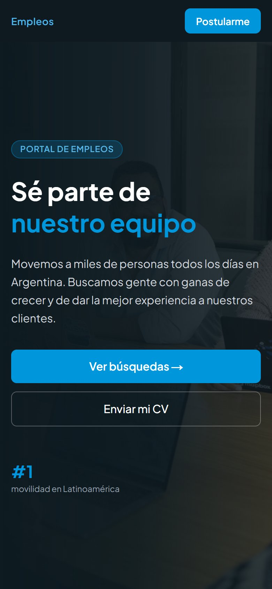
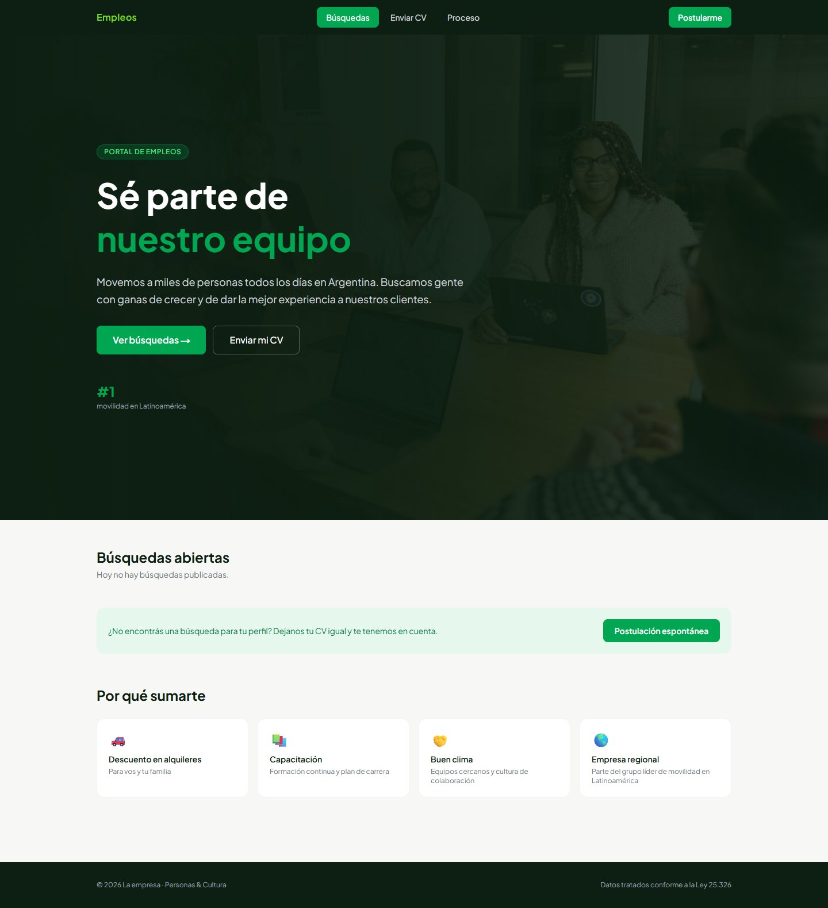
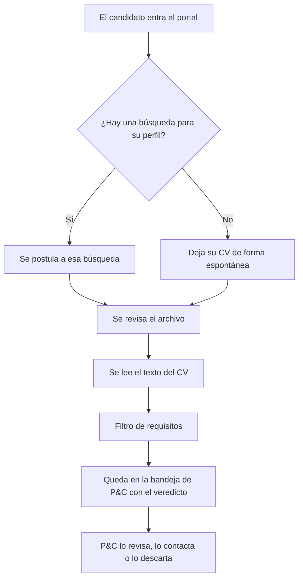
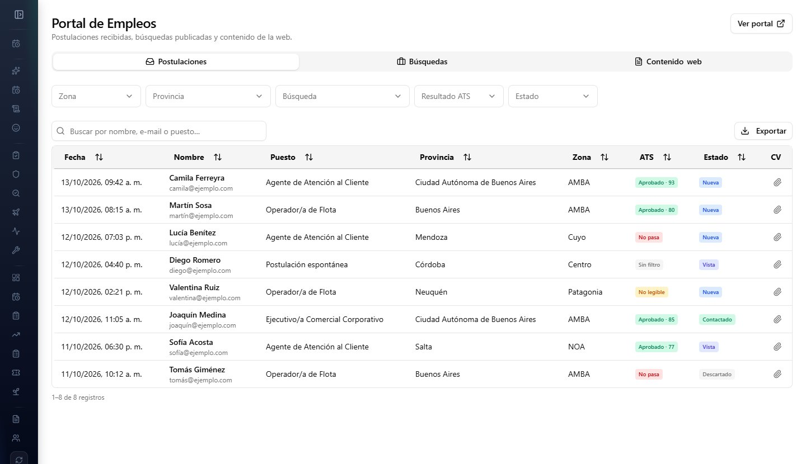
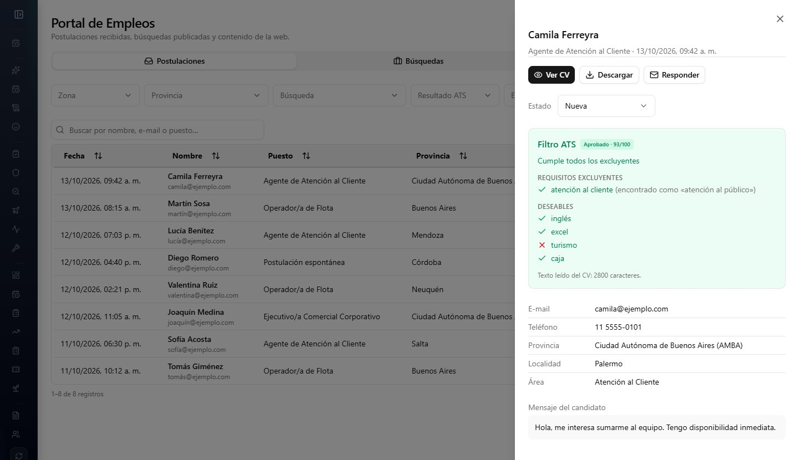
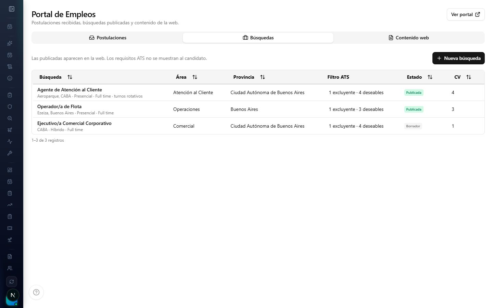
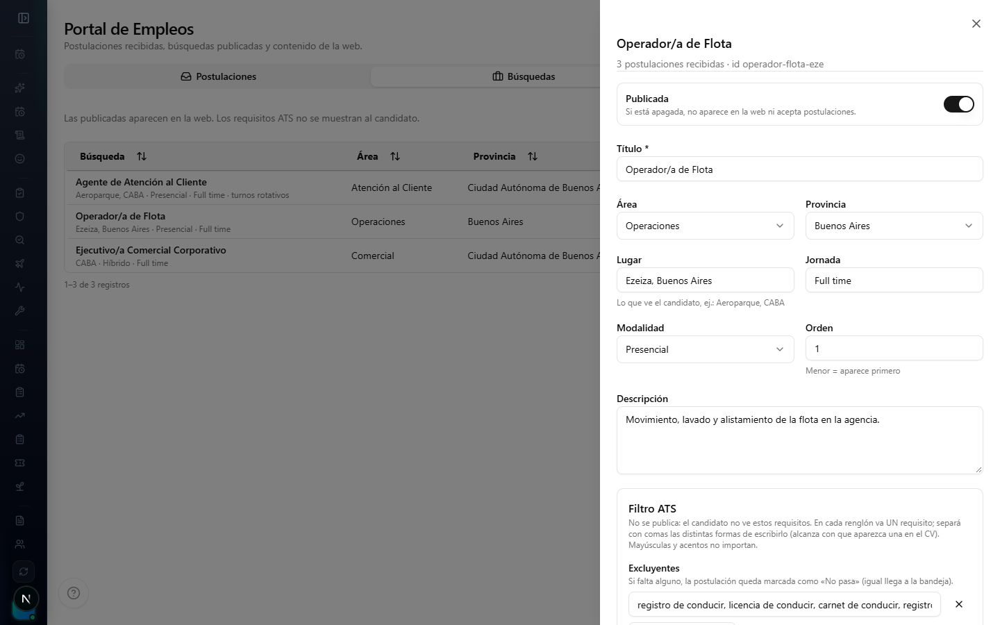
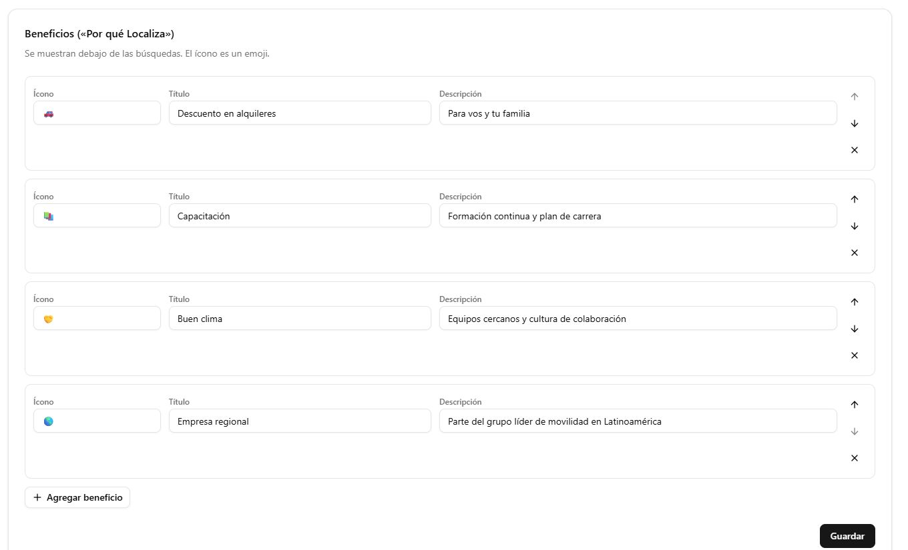
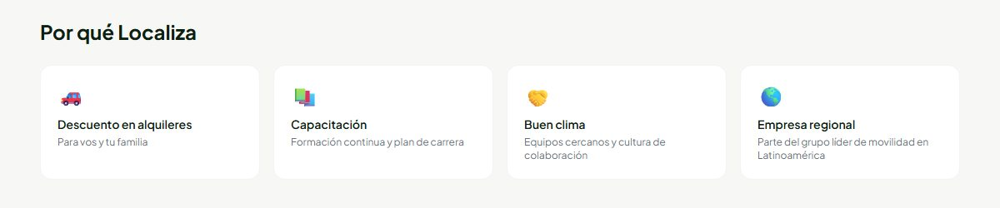
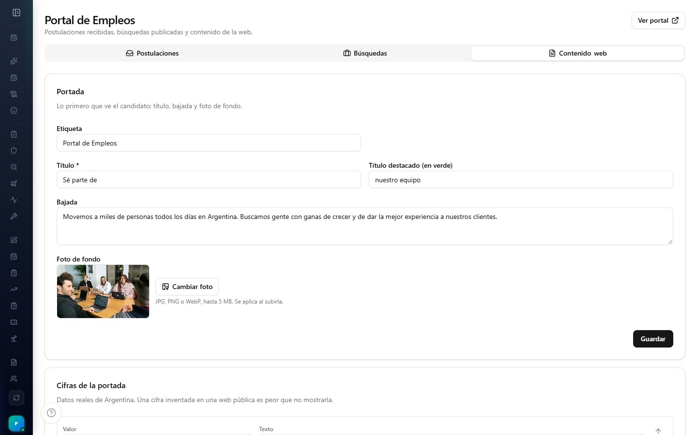

# Portal de Empleos

**Estado:** En producción · [empleos.ldmtapp.com](https://empleos.ldmtapp.com)

## Resumen

Una web pública de empleos donde cualquiera ve las búsquedas abiertas y deja su CV. Cada CV pasa por un filtro de requisitos y queda en una bandeja interna, donde Personas & Cultura lo revisa por zona y provincia. Desde el mismo panel, P&C publica las búsquedas y cambia los textos y las fotos de la web sin pasar por Sistemas.

  
  &nbsp;
  

## Problema que resuelve

- Los CV llegaban por donde cayera: el WhatsApp de un encargado, en papel en el mostrador, una casilla personal. En el camino se perdían candidatos.
- Había idas y vueltas para pedir el teléfono o saber para qué puesto era la postulación.
- Localiza Argentina no tenía una página propia de empleos.

## Qué es

- **Una web abierta.** Sin usuario ni contraseña, con dirección propia. El link se comparte en redes, en la firma del mail o en un QR en las sucursales.
- **Postulación en un paso.** El candidato adjunta el CV y completa nombre, mail, teléfono, localidad, provincia, área, LinkedIn y un mensaje. Puede elegir una búsqueda o dejar el CV para el futuro.
- **Un panel para Personas & Cultura.** Dentro de la app interna, con tres pestañas: postulaciones, búsquedas y contenido de la web.

## El recorrido de un CV

1. **Entra por el portal.** Elige una búsqueda abierta o se postula de forma espontánea.
2. **Se revisa el archivo.** Sólo PDF o Word, hasta 5 MB. Se verifica que el archivo sea lo que dice ser y se frenan los envíos automáticos de robots.
3. **Se lee el texto del CV.** El sistema abre el documento y extrae su contenido para compararlo.
4. **Pasa por el filtro.** Se compara con los requisitos cargados para esa búsqueda, excluyentes y deseables.
5. **Queda en la bandeja.** Con el resultado del filtro, los datos del formulario, la provincia y la zona del país. El CV no viaja por mail: sólo lo ve quien tiene el permiso del panel.

## El panel de Personas & Cultura

### Postulaciones

Desplegables para filtrar por **zona** (AMBA, Centro, Cuyo, NOA, NEA, Patagonia), **provincia**, **búsqueda**, **resultado del filtro** y **estado**. Lo que se ve se exporta a Excel.

Al abrir una postulación se ve el filtro requisito por requisito (con la palabra que encontró en el CV), los datos del candidato, su mensaje y los botones para ver el CV y responderle. El estado pasa de *Nueva* a *Vista*, y después a *Contactado* o *Descartado*.

### Búsquedas

| Lista | Editor |
|---|---|
|  |  |

P&C da de alta, edita, pausa o borra búsquedas. Cada una tiene su interruptor **Publicada** y su propio filtro de requisitos.

### Contenido web

Toda la web se edita desde el panel: portada (con su foto de fondo), cifras, beneficios, pasos del proceso, preguntas frecuentes y áreas. Cada sección tiene su botón **Guardar** y el cambio se ve en la web al instante, sin pedirle nada a Sistemas.

| Lo que edita P&C | Lo que ve el candidato |
|---|---|
|  |  |

## Cómo decide el filtro

Cada búsqueda tiene dos listas de requisitos:

- **Excluyentes:** si el CV no menciona alguno, la postulación queda marcada como «no pasa».
- **Deseables:** no bloquean nunca, sólo suman puntaje.

Cada requisito se carga con sus variantes ("registro de conducir", "licencia de conducir", "carnet de conducir") y alcanza con que aparezca una. No distingue mayúsculas ni acentos.

El puntaje va de 0 a 100: los excluyentes pesan 70 y los deseables, 30.

| Veredicto | Cuándo |
|---|---|
| Aprobado | Están todos los excluyentes. El puntaje ordena la lista |
| No pasa | Falta algún excluyente, y el detalle dice cuál. **Llega igual:** el filtro ordena, no descarta |
| No legible | No se pudo leer el CV (una foto, un PDF escaneado o un Word viejo). Va a revisión manual |
| Sin filtro | Postulación espontánea o búsqueda sin requisitos |

Los requisitos no se publican en la web. Si el candidato los viera, los copiaría en el CV y el filtro dejaría de servir.

## Qué mejora para Personas & Cultura

- **No se pierden candidatos en el camino.** Todos los CV entran por el mismo lugar y con los mismos datos.
- **Menos idas y vueltas.** El CV llega con mail, teléfono, localidad, provincia y área ya cargados.
- **La bandeja se ordena sola.** Por veredicto, puntaje y zona del país.
- **Autonomía.** Textos, fotos y búsquedas se cambian desde el panel, sin depender de Sistemas.
- **Llega filtrado.** Se rechazan los archivos que no son CV y los envíos automáticos.
- **Imagen de empleador.** Una página con la marca, los beneficios y el proceso explicado.
- **Datos personales en regla.** Los CV no circulan por mail y sólo los ve quien tiene el permiso. El formulario aclara que la información se usa sólo para selección, según la Ley 25.326 de Protección de Datos Personales.

## Qué sigue

- Dar el permiso del panel al equipo de Personas & Cultura.
- Cargar las búsquedas reales con sus requisitos.
- Definir cuánto tiempo se guardan los CV.

> Las capturas de la web son de producción. Las del panel usan postulaciones de ejemplo: los nombres y mails son ficticios.
